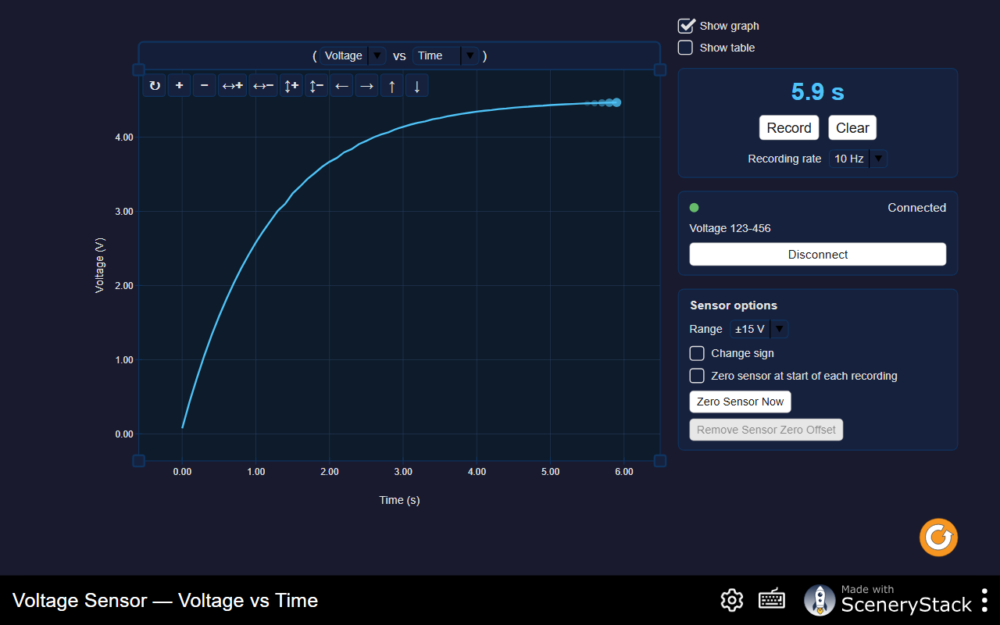
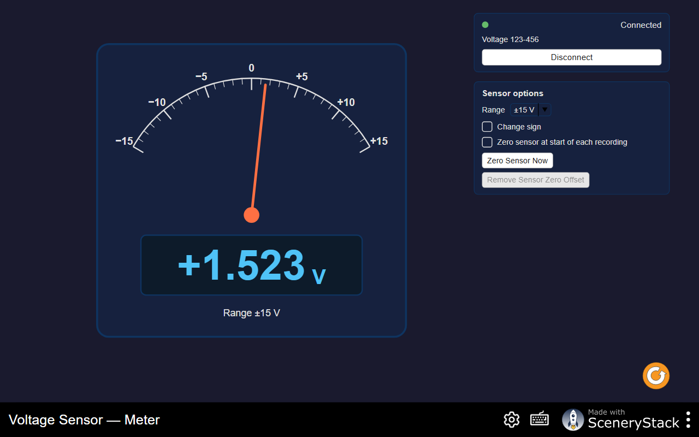

# Voltage Sensor

[](../../actions/workflows/ci.yml)
[](../../actions/workflows/deploy.yml)

**Live app: <https://troymessina.github.io/VoltageSensor/>**

A web interface for the **PASCO Wireless Voltage Sensor (PS-3211)**. It connects
straight from the browser over Web Bluetooth (or a USB cable), with no driver,
app, or install. It has two screens:

- **Meter**: a live voltmeter with a centre-zero needle dial and a large digital
  readout to the millivolt.
- **Voltage vs Time**: records the voltage at a rate you choose (1, 2, 5, 10, 20
  or 50 Hz) onto a graph you can zoom, pan and resize. It also shows a table of
  the values, which you can download as CSV.





## Using it

1. Open the app in **Chrome, Edge or Opera** on a laptop, Chromebook or Android
   device. (Firefox and Safari have neither Web Bluetooth nor WebUSB; the app
   says so instead of offering a button that cannot work.)
2. Switch the PS-3211 on.
3. Press **Connect by Bluetooth** and choose the sensor in the browser's list.
   It appears as *Voltage* followed by its serial number. Or plug it in with a
   USB cable and press **Connect by USB**.
4. Read the **Meter**, or go to **Voltage vs Time**, pick a **Recording rate**,
   and press **Record**.

One connection serves both screens: connect on either one and both read. A
recording keeps running if you switch to the Meter screen to glance at it.

### The graph

- **Zoom both axes**: the **+** / **−** buttons, or the mouse wheel over the plot.
- **Zoom one axis**: **↔+ / ↔−** (horizontal) and **↕+ / ↕−** (vertical), or
  the mouse wheel over that axis's numbers, or drag along an axis.
- **Pan**: the arrow buttons, or drag the plot.
- **Pinch** to zoom on a touch screen.
- **↻** rescales to fit the data and turns auto-scaling back on. Any manual
  zoom or pan turns auto-scaling off, so it sticks while a recording runs.
- Drag the header bar to move the graph. Drag a corner to resize it.
- The axis pickers in the header swap which quantity is on which axis.

### Sensor options

These are the same settings PASCO's SPARKvue offers for this sensor:

| Option | What it does |
|---|---|
| **Range** ±15 V / ±5 V | The sensor's input range. ±5 V gives three times finer resolution. The range is sent to the sensor, which powers up on ±15 V. |
| **Change sign** | Negates the reading, the same as swapping the red and black leads. |
| **Zero sensor at start of each recording** | Each run records the change from wherever it started. |
| **Zero Sensor Now** / **Remove Sensor Zero Offset** | Take the present reading as zero, or go back to the sensor's own zero. |

Change sign, the zero buttons and the range are locked while a recording runs,
because changing them mid-run would put a step into the trace that the circuit
never made.

### Recording limits

A recording stops on its own after 10 minutes or 6000 samples, whichever comes
first: 10 minutes at up to 10 Hz, 5 minutes at 20 Hz, 2 minutes at 50 Hz. Over
Bluetooth, each reading is one round trip of a few tens of milliseconds. At
50 Hz, some samples may therefore repeat the previous reading. Over USB the
sensor keeps its own clock and streams.

## ⚠ Verify against a known voltage

This app talks to the sensor using PASCO's published datasheet for the PS-3211.
It was **not** tested against a physical sensor while it was being written. The
first time you use it, read a known source, such as a fresh 1.5 V cell or a
bench supply, on **both** ranges.

If the reading is off by a factor of three, the sensor did not take the range
command. A yellow warning appears in the connection panel when the sensor does
not confirm the range.

For hardware bring-up, add `?showDiagnostics=true` to the URL. It shows the
raw 16-bit count and the calibrated voltage of every reading, and logs each one
to the browser console. See [AGENTS.md](AGENTS.md) for the other query
parameters.

## Development

```bash
npm install
npm start          # → http://localhost:5173
```

Web Bluetooth and WebUSB need a secure origin. `localhost` counts as one, and
so does the deployed HTTPS site.

| Command | Description |
|---|---|
| `npm start` / `npm run dev` | Start the Vite dev server |
| `npm run build` | Type-check + production build → `dist/` |
| `npm run build:single` | One self-contained `dist/index.html` (for opening from disk or an LMS) |
| `npm run preview` | Preview the production build locally |
| `npm test` | Vitest unit tests (including the memory-leak suite) |
| `npm run check` | TypeScript type check (app, scripts and tests) |
| `npm run lint` | Biome lint |
| `npm run check:architecture` | dependency-cruiser layer rules |
| `npm run check:unused` | knip: unused files, exports and dependencies |
| `npm run icons` | Regenerate the PNG icons from `public/icons/icon.svg` |

Pushing to `main` runs CI and deploys to GitHub Pages
(`.github/workflows/deploy.yml`).

## Tech stack

The same stack as OpenLyceum's
[MotionSensor](https://github.com/OpenLyceum/MotionSensor) and
[RadioactivityAndStatistics](https://github.com/OpenLyceum/RadioactivityAndStatistics),
which this app is built from:

| Tool | Version | Notes |
|---|---|---|
| SceneryStack | ^3.0.0 | UI framework; `bamboo` for the graph |
| Web Bluetooth / WebUSB | browser APIs | Direct, dependency-free PS-3211 communication |
| Vite | ^8 | Build tool and dev server |
| TypeScript | ^7 | `erasableSyntaxOnly`: no `enum`, no `namespace` |
| Biome | ^2 | Lint + format |
| Vitest | ^5 | Unit tests (`happy-dom`) |
| Playwright | ^1 | Fuzz smoke test |
| vite-plugin-pwa | ^2 | Installable / offline |

Also available in French and Spanish (Preferences → Language), with a
projector-friendly colour profile (Preferences → Visual).

## License

GNU Affero General Public License v3.0 or later. See [LICENSE](LICENSE).
Derived from OpenLyceum simulations under the same license; see
[CREDITS.md](CREDITS.md). Not affiliated with or endorsed by PASCO Scientific.
